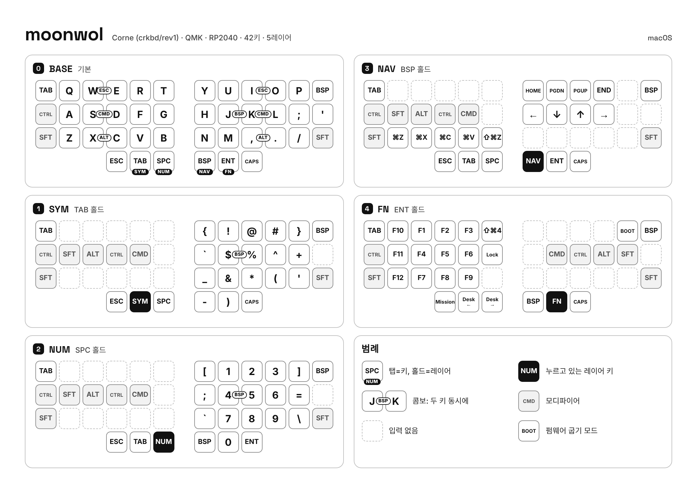
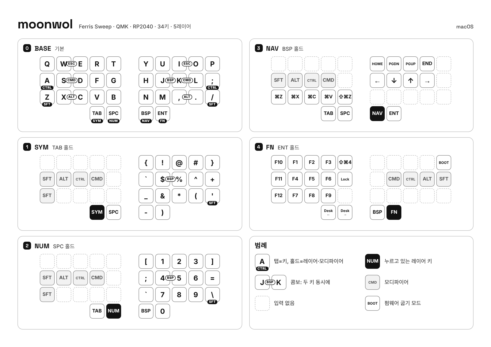

# moonwol — A Simple Keymap for 34-Key and 42-Key Keyboards

I tried hard to settle on an existing keymap, but every one I tried had something that bugged me.

So I figured: why not make my own?

> ...after countless eons of tinkering...

Boom. Meet **moonwol**.

## moonwol v2

This is the second version of moonwol. After using v1 for a while, I fixed the parts that kept bugging me, using [Miryoku](https://github.com/manna-harbour/miryoku) as a reference:

- **Mods on every layer.** Each non-base layer has Shift/Alt/Ctrl/Cmd on the home row of the hand that isn't busy, so I can hold a layer and add modifiers without moving.
- **Numpad-shaped numbers and F-keys.** Numbers moved from the top row into a 3×3 grid, and F1–F12 follow the same shape.
- **Editing on the nav layer.** Arrows sit on `HJKL`, with Undo/Cut/Copy/Paste/Redo on the other hand.
- **Thumbs carry the layers.** Each thumb key taps as a key and holds as a layer.

What I did *not* take from Miryoku is home row mods on the base layer. See below for why.

moonwol v2 comes in two versions that share the same layers, combos and QMK config:

| Keyboard | Keys | QMK keyboard | Layout macro |
|---|---|---|---|
| Corne (crkbd) | 42 | `crkbd/rev1` | `LAYOUT_split_3x6_3` |
| Ferris Sweep | 34 | `ferris/sweep` | `LAYOUT_split_3x5_2` |

## Design Principles

1. Easy to adapt to
2. No home row mods
3. UNIX-friendly

### 1. Easy to Adapt To

I came from compact layouts ([ErgoDash](https://github.com/omkbd/ergodash) and the [Logi K380](https://www.logitech.com/en-us/products/keyboards/k380-multi-device.920-011135.html)), so I kept things as familiar as possible to make the switch quick and painless.

### 2. No Home Row Mods

Honestly, I'm not a great typist: about 85 WPM in English and 500 strokes per minute in Korean. So I thought:

> I'm slow enough to handle home row mods!

Nope.

Home row mods slowed me to a crawl and made typing miserable, so I ditched them.

Modifiers live on combos (`S`+`D` = Cmd, `X`+`C` = Alt, ...) and on the home row of every non-base layer instead. The one exception is the 34-key version: it has no outer columns, so the outer pinky keys (`A`, `Z`, `;`, `/`) double as Ctrl and Shift.

### 3. UNIX-Friendly

Yes, Windows dominates the market, but I don't care. I use a Mac as my daily driver and Linux as my backup machine.

Layers are built around macOS shortcuts (Cmd+Z/X/C/V, screenshot, lock screen, desktop switching). Korean/English input is switched with Ctrl+Space, so there's no dedicated IME key.

## Layers

bottom badges mark tap-hold keys; hanging badges mark combos.

### crkbd (Corne, 42-key) version


### Sweep (34-key) version


## Build

Both versions share the same `config.h` and `rules.mk`:

- `TAPPING_TERM 200`, `PERMISSIVE_HOLD`
- `COMBO_TERM 40`
- `EE_HANDS` (each half remembers whether it is left or right)
- `LTO_ENABLE` (smaller firmware)

They are set up for an **RP2040** controller by default. For a **Pro Micro**, see [Pro Micro](#pro-micro-atmega32u4) below.

### 1. Copy the keymap into `qmk_firmware`

| Keyboard | From this repo | To |
|---|---|---|
| Corne | `crkbd/` | `keyboards/crkbd/keymaps/moonwol/` |
| Sweep | `sweep/` | `keyboards/ferris/keymaps/moonwol/` |

```sh
cp -r crkbd ~/qmk_firmware/keyboards/crkbd/keymaps/moonwol
cp -r sweep ~/qmk_firmware/keyboards/ferris/keymaps/moonwol
```

### 2. Build and flash

#### RP2040

Nothing to change. `rules.mk` already has `CONVERT_TO = rp2040_ce`, which builds for RP2040 boards that use the Pro Micro footprint.

```sh
qmk compile -kb crkbd/rev1 -km moonwol
qmk compile -kb ferris/sweep -km moonwol
```

Because of `EE_HANDS`, flash each half with its handedness:

```sh
# left half
qmk flash -kb crkbd/rev1 -km moonwol -bl uf2-split-left
# right half
qmk flash -kb crkbd/rev1 -km moonwol -bl uf2-split-right
```

For the Sweep, use `-kb ferris/sweep` instead.

To get into the bootloader, double-tap the reset button (`RP2040_BOOTLOADER_DOUBLE_TAP_RESET`) or press `BOOT` on the FN layer. The half shows up as a drive named `RPI-RP2`, and `qmk flash` copies the firmware onto it.

#### Pro Micro (ATmega32U4)

Remove the RP2040 lines first:

```diff
 # rules.mk
-CONVERT_TO = rp2040_ce
```

```diff
 // config.h
-#define RP2040_BOOTLOADER_DOUBLE_TAP_RESET
```

Then build the same way:

```sh
qmk compile -kb crkbd/rev1 -km moonwol
qmk compile -kb ferris/sweep -km moonwol
```

Flash each half with its handedness:

```sh
# left half
qmk flash -kb crkbd/rev1 -km moonwol -bl avrdude-split-left
# right half
qmk flash -kb crkbd/rev1 -km moonwol -bl avrdude-split-right
```

For the Sweep, use `-kb ferris/sweep` instead.

When `qmk flash` starts waiting for the board, press the reset button (or short `RST` and `GND`) or press `BOOT` on the FN layer.

## License

    A Simple Keyboard Layout For 34-key and 42-key Keyboards
    Copyright (C) 2023  Mun Junsang

    This program is free software: you can redistribute it and/or modify
    it under the terms of the GNU General Public License as published by
    the Free Software Foundation, either version 3 of the License, or
    (at your option) any later version.

    This program is distributed in the hope that it will be useful,
    but WITHOUT ANY WARRANTY; without even the implied warranty of
    MERCHANTABILITY or FITNESS FOR A PARTICULAR PURPOSE.  See the
    GNU General Public License for more details.

    You should have received a copy of the GNU General Public License
    along with this program.  If not, see <https://www.gnu.org/licenses/>.